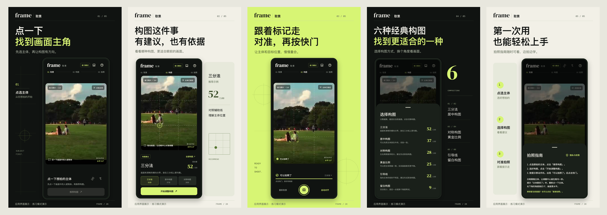

# FRAME

[简体中文](README.md) | [English](README.en.md)

A Flutter composition camera for learning and research: select a subject, compare six classic compositions, and follow live alignment guides. Scene analysis stays on the device.

## Download

| Platform | Download |
| --- | --- |
| Android | APK download link to be added |
| iOS | Installation or TestFlight link to be added |

<!-- Replace these placeholders only when a verified build is available. -->
No downloads are available here yet. Build locally using the instructions below.

## Quick start

Install **Flutter 3.47.6**, Git and Chrome:

~~~sh
git clone https://github.com/lianjiehao/frameapp.git
cd frameapp
flutter pub get --enforce-lockfile
flutter run -d chrome
~~~

Web provides practice mode only. For Android 7.0+, run `flutter run -d <device-id>`; add `--dart-define=DEMO_MODE=true` for mobile practice mode. iOS 15+ needs macOS, Xcode and your own development team; see [iOS setup](docs/ios-setup.md). Help and policy pages render locally.

## Develop and contribute

- [App overview](docs/app.md): features and limitations.
- [Architecture](docs/architecture.md) · [Contributing](CONTRIBUTING.en.md): source map, checks and PR workflow.
- [AI-assisted development](docs/ai-development.md): project rules, task examples and the commit skill.
- [REA feature research](docs/rea.md): study features of software you own or are authorized to examine with the optional `frame-rea` skill.
- [Software copyright materials](docs/distribution/README.en.md): adaptable templates and a PDF generator.

## Legal and license

Code is licensed under [MIT](LICENSE); dependencies, fonts and assets retain [their own licenses](THIRD_PARTY_NOTICES.md). Demonstrations and research workflows support learning and research without restricting MIT's commercial-use, modification or distribution rights.

The software is provided as is. Use, research and distribution require appropriate authorization and respect for copyright, privacy and image rights. Disclaimers cannot waive liability that the law does not allow to be excluded; see [usage and licensing boundaries](docs/legal.md). For security issues, see [SECURITY.md](SECURITY.md).
