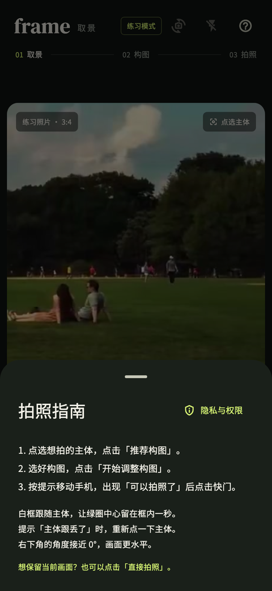

# 取景：应用介绍

[English](app.md) | [简体中文](app.zh-CN.md)

取景帮助你在按快门前确定主体的位置。先选择想拍的对象，再比较构图建议，跟随标记调整画面。最终采用哪种构图、何时拍照，都由你决定。

## 三步拍照

| 1. 点选主体 | 2. 比较构图 | 3. 对齐拍照 |
| --- | --- | --- |
|  |  |  |
| 点击想拍的对象，白框表示正在跟踪。 | 查看推荐、理由和备选方案。 | 让绿圈中心留在主体选框内一秒，再按快门；允许框内轻微手抖。 |

截图为中文界面的练习模式。App 暂未提供英文界面。

## 已有功能

- 六种构图：三分法、居中、对称、黄金比例、引导线和留白。
- 主体跟踪、目标标记和移动方向提示；内置拍照指南说明操作步骤。
- 切换前后镜头、闪光灯、直接拍照，以及最近一张照片预览。
- 保存不含引导线的 3:4 PNG 照片。保存失败时，只要当前照片仍在内存，就可以重试。
- 使用内置样片练习；浏览器中可拖动场景或自动对齐，再下载拍摄结果。

  
  

## 隐私与自主选择

实时画面和照片在设备内处理，不使用云端识别服务，无需账号或 API key。相机和保存权限在需要时申请，可在隐私页面撤回同意；已经存入系统相册的照片仍由你管理。

帮助与政策页面随应用提供，在本地渲染。开发者可按需修改 [政策内容](../policies/README.md)。

## 使用边界

构图建议来自画面结构测量和本机规则，没有接入语义识别或训练过的审美模型。分数用于比较当前候选构图，不代表照片质量认证。低纹理、低光、重复图案、遮挡和快速移动可能造成跟丢，需要重新点选。

目标在主体选框内保持一秒后即可拍照，框内轻微移动不会重新计时。目标出框、跟丢、画面过期或剧烈晃动会重置就绪状态。水平及画面结构建议是可选项；也可以选择直接拍照。Android / iOS 提供真实相机功能，浏览器用于练习。不同手机的实际表现需要真机验证。

遇到可复现的问题，请提交 [GitHub Issue](https://github.com/lianjiehao/frameapp/issues)，说明版本、设备和步骤，截图中请遮挡个人信息。
